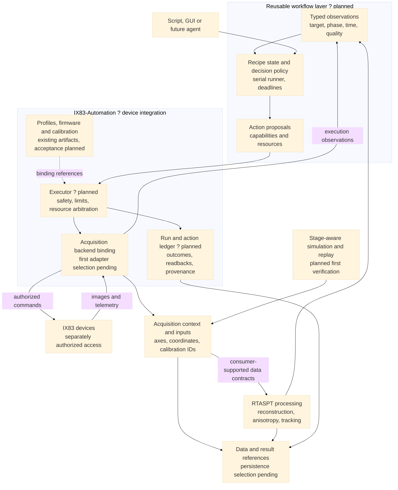

# IX83-Automation architecture flowchart

This planned composition follows the [setup plan](device_bundle_setup_plan.md) and RTASPT's [sample-search workflow research](../03_external/Realtime-Anisotropy-SPT-Analysis/docs/sample-search-workflow-research.md). Workflow packaging, executor implementation and RTASPT extraction are not claimed complete.

First planned verification: same-objective survey, calibrated detection, physical-coordinate deduplication and selection, then full acquisition of selected targets and RTASPT processing. Baseline/perfusion/anisotropy is the second proposed reference recipe.

Processing reports observations; the bundle executor owns physical commands. The existing RTASPT live workflow uses Micro-Manager/Pycro-Manager and napari with exclusive camera ownership. Generic input adapters exist, but ndarray/TIFF consumers and the current live controller retain their documented limitations.
