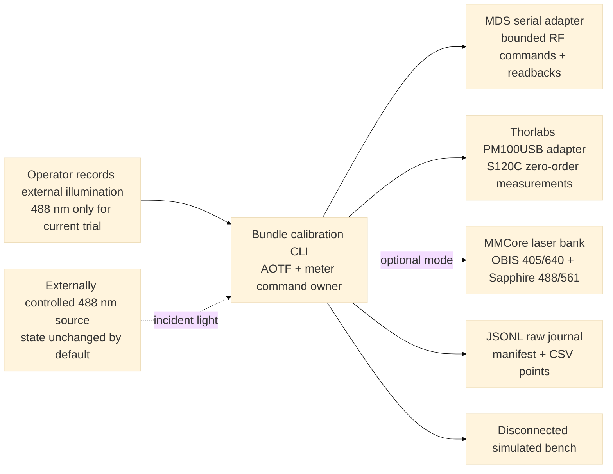

# IX83-Automation architecture flowchart

**Isolated AOTF calibration utility (2026-10-24):** the bundle-owned
[`04_code/aotf_calibration`](../04_code/aotf_calibration/README.md) CLI owns
bounded MDS RF commands and PM100USB/S120C measurements only during a separate
operator-supervised calibration. Other owners of these resources must be
stopped. The current primary path leaves 488 nm laser state externally
controlled and records it as the incident illumination. Optional native MMCore
OBIS/Sapphire control remains a separate mode. The caller-injected optical
engine creates no RunEngine and has no mechanical shutter authority. Simulation
and optional transport code are implemented; 488 nm hardware qualification and
calibration acceptance remain pending.



**Saved-snap review UI (2026-10-20):** the checkpoint plan emits its local HTML
path and manifest digest to a Plan review dock. The dock embeds Qt WebEngine when
available, handles the exported JSON download, and offers a system-browser
fallback when WebEngine is unavailable or the page fails to load. Applying a review decision remains a separate explicit
Presenter action.

This composition follows the [setup plan](device_bundle_setup_plan.md) and the adopted [redsun-searching-is-imaging application](../03_external/redsun-searching-is-imaging/README.md), with the bundle's [sample search workflow research](sample_search_workflow_research.md). The mock-first camera/XYZ-stage package exists at `04_code/ix83_acquisition/`; capture, XYZ movement, finite acquisition and free-run cancellation passed over demo ZMQ on 2026-10-04. RTASPT CLI/GUI/MDA backend-injection checks are historical; that frontend was removed on 2026-10-17. The retained integration is recorded-plane handoff, with processing-only slit/observation APIs in RTASPT. See the plan for tested versions and compatibility limits. The reusable sample-search source now builds as the local `redsun-planner` distribution with canonical import `planner`; the acquisition project's locked local path dependency builds and installs its wheel. `planner` is the only importable name; the former `samplescout` shim was removed. The planner source is pinned as a bundle submodule; an independent package release, portable consumer dependency reference and finalized hardware adapter contract remain planned. The `04_code/ix83_acquisition/` package is the current Pycro-Manager compatibility and parity baseline; the mid-term target is to port its full functional stack into `redsun-searching-is-imaging` on the existing Redsun session, services, Ophyd-async, RunEngine, Presenter, callback and storage infrastructure. Keep the current package until module-level parity and applicable acceptance pass. The primary application has geometry-only scan previews, a hash-checked registered-coverage overlay, bounded snap binding and persistence, and an opt-in native broom Presenter composition. Complete capability/limit/resource preflight and physical scan acceptance remain planned; the Qt coverage dock still needs normal-host GUI review. The OxiSerial Ludl path has a hardware-free MAC6000 codec/client for position reads, raw-count moves and status reports, with an explicit-calibration XY facade bounded to ±2 mm from service startup. A managed native `ludl_stage` service, monitored telemetry client, and native Ludl + MMCore broom Presenter composition now exist and pass fake-peer/mock tests. Physical module mapping, counts-to-distance calibration, timed-report verification and hardware qualification remain pending. A separate Redsun-managed direct-serial optics service adapts the original laser command families and the Arduino shutter controller without MM laser adapters; laser COM mapping, shutter firmware/wiring checks and physical optical acceptance remain pending. Seeded and recording/replay checks pass. A six-position 50 x 25 um mechanical scan passed on Pycro-Manager with checksum-verified frames and bounded return to origin; optical calibration and real-specimen targeting remain unverified. The saved-checkpoint review CLI and survey coverage GUI are implemented. The first IX83 recipe now specifies operator-confirmed well corners, IX83 body focus-lock, median channel maps and paired-channel intensity suggestions; the production well-corner GUI, relative-focus binding, Otsu proposal generation, split-detector calibration and channel-group MDA remain planned.

`redsun-planner` is a reusable Bluesky plan-generator library: its building blocks wrap existing plan stubs or provide customized subplans, and higher-level recipes compose those blocks. The primary workflow is Redsun-bound: the Presenter plan-map registers geometry previews, bounded snap plans, and a native Ludl + MMCore broom entry. The broom entry composes caller-supplied devices, checks the live route envelope and exposure bound, passes the selected auto-shutter device and returns to the captured anchor after successful completion. Its plan composition is mock-tested; physical controller calibration, telemetry and motion acceptance remain pending. A simulation-only managed broom service also completes through a headless Redsun Session, Presenter plan map, RunEngine and loopback PVA, persisting three snake-strip Zarr stores through the same `acquire_zarr.ZarrStream` writer used by the in-process Demo route. This does not qualify physical broom motion or UI presentation; see the [run evidence](../08_session_logs/20261017T152410Z_managed_demo_broom_pva_headless/README.md). Assess `bluesky-adaptive` at the Presenter composition layer. Non-Redsun consumers may use compatible interfaces/adapters, supplied as supporting examples or skills rather than primary workflow implementations. The planner has no Redsun runtime dependency, creates no RunEngine and owns no instrument device calls. The temporary IX83 bundle has a bounded combined-XY Pycro-Manager/Ophyd snap binding, tested with a fake Core; the broader plan-message surface and physical continuous flyer binding remain planned. The primary application also has a MAC6000 codec/client, a calibrated XY facade and a registered native `ludl_stage` service with telemetry, traverse and stop APIs. The registered-support coverage preview is implemented; normal-host GUI review remains pending. Physical device preflight, live controller report verification, native calibration and physical acceptance remain planned. Each run has one active engine and physical command authority; Redsun and Pycro-Manager are alternative composition/execution paths, not parallel controllers. Independent upstream release and a finalized hardware adapter contract remain planned. A heavy block-processing service remains optional and measurement-driven. Upstream redsun-mimir main `293e8ba0f2f5229eb5ca202e372647dd9338f216` and official release `v0.5.1` are the adopted architecture/mainline source; they do not supply a Ludl protocol. Preserve applicable session, service, storage, UI and engineering parity. Official upstream main/release identity is verified; IX83 runtime acceptance remains pending.

**Presenter replay integration (2026-10-19):** an opt-in plan-map action reads a verified closed run, streams one Zarr strip with its source frame context, and injects RTASPT's slit worker into a new Redsun `LiveComposition`. Normal session startup does not import RTASPT, which is imported only when this action runs. The action records scalar operating-point observations, emits slit, background, en-face and TDI products through a Presenter signal into dedicated `ImageView` layers, and writes incremental BigTIFF stacks with explicit TYX axes, a per-frame plane map and completeness manifest. The actual RTASPT CPU replay produced eight slit planes and four ready planes each for background, en-face and TDI; the output run integrity and per-frame map were checked. The focused host tests passed (19 passed, 9 OpenGL skips) and Ruff passed; host Qt review is pending. The separate host CLI exports derived images and ROI/speed diagnostic plots. It issues no device commands and establishes no live feedback timing. See [slice evidence](../08_session_logs/20261019T_rtaspt_presenter_view_01/README.md). **Broom capture handoff (2026-10-19):** `scripts/process_broom_capture_rtaspt.py` now chains geometry/context export and RTASPT replay for a completed MMCore broom Zarr. On a copied managed Demo strip, 20/20 simulated exposure/pose/cadence rows produced 20 operating-point observations and 14 TDI planes. Physical timing and pose remain unqualified; see [bridge validation evidence](../08_session_logs/20261019T_redsun_broom_rtaspt_bridge_validation_01/README.md).

**Saved-stack pair registration (2026-10-21):** Redsun's Presenter can opt into RTASPT PCC-seeded translation ECC for each selected image pair. RTASPT provides pairwise content displacements; Redsun converts them to its placement convention, then retains the checksummed registration record, placement graph, cycle gates and mosaic renderer. The normal Redsun backend remains the default, and RTASPT is imported only when selected. The 543-frame broom replay with 35 sampled frames accepted 51/67 edges at score threshold 0.5, producing 7 components and a 23-frame largest component with 0.0211 px cycle RMS; evidence is in the [matched registration record](../07_experiment_notebook/2026-10-21_redsun_rtaspt_broom_registration_comparison.md). This is a partial image-only replay, not a calibrated pose map or full-strip acceptance.

**GPU median ROI observer (2026-10-20):** the native broom Presenter has an opt-in `gpu_median` trace. Its MMCore camera port enables the camera's eight-slot shared ring and attaches the existing pinned GPU buffer before the stage traverse. It records source/run frame ordinals, ring drops, upload and observer time, and a proposal-only speed curve. The mock lifecycle and Presenter regressions passed. Actual CUDA testing on the GTX 1070 processed synthetic full-resolution frames with no ring drops. Managed loopback PVA DemoCamera integration also delivered 16/16 frames through the bounded shared and pinned rings, with zero losses, writer drops or writer blocks; GPU median plus detector took 0.544 ms median / 0.677 ms p95 at fixture resolution. These checks do not qualify full-resolution PVA transport, PVCAM cadence, exposure timing, trigger accuracy or stage-speed control. See the [managed PVA/GPU evidence](../08_session_logs/20261019T_gpu_median_pva_observer_01/README.md), [targeted regression](../08_session_logs/20261019T123152_gpu_roi_final_regression/README.md) and [CUDA probe](../08_session_logs/20261019T123000_actual_cupy_median_probe/README.md). Next gates are sustained full-resolution delivery with occupancy and event-latency accounting, then held-out labeled edge-entry evaluation; live speed proposals remain non-actuating.

**Planner policy boundary (2026-10-20):** Redsun computes the selected ROI scalar on the bounded GPU path and passes that scalar to `planner.RoiIntensitySpeedPolicy`, which owns the reusable causal rise detector and optional acceleration-limited speed proposal. The policy sees no image arrays and emits no device commands; calibration, trace persistence, timing and execution limits remain at the acquisition host.

**ix71 ASI integration (2026-10-22):** the temporary `ix71-system` replaces the IX83 Ludl XY stage with a native serial ASI MS2000/LX4000 stage on COM5. The application now has an ASI `2H` ASCII client, a bounded XY facade, a FastCS/PVAccess service and an Ophyd-async device with the same `xy` + `motion` shape the planner already consumes. The ix71 profile declares the ASI stage and a DemoCamera but no Ludl or IX83 optics service; those components remain in code for the IX83 profiles. First physical evidence is limited to a ±100 µm envelope and a four-frame DemoCamera snap; absolute scale, the expected PVCAM camera, 60× optical calibration and optics/laser operation remain open. See the [ix71 setup plan](ix71_system_bundle_setup_plan.md) and [first motion record](../08_session_logs/20261022T_ix71_asi_motion_01/README.md).

**ix71 update (2026-10-25):** three of that paragraph's open items have closed and one profile has been added, so the composition below shows them. The **motion envelope is 1500 µm** in both ix71 profiles (the ±100 µm guard refused legal recentring), `counts-per-um` is **5.0** (controller counts 0.2 µm per count), so service coordinates are physical micrometres, and the **PVCAM Camera-1 is the working camera** (`ix71_asi_pvcam`). The sampling is **0.18333 µm/px** (11 µm pixels at 60×), confirmed by the MR095 reticle at 0.1823–0.1829 µm/px. The `ix71-asi-sapphire` command adds `ix71_asi_pvcam_sapphire`, which declares the **`laser488`** light device served by the existing optics service's 488 channel on **COM4**; the democam and pvcam profiles still declare no optics service. Still open: absolute scale against an independent reference at the current position, the 60× optical calibration statement, and any physical acceptance of the survey/review/revisit plans. See the [ix71 setup plan](ix71_system_bundle_setup_plan.md) and the [illumination closeout](../08_session_logs/20261024T_ix71_illumination_closeout_01/README.md).

```mermaid
%%{init: {"theme": "base", "themeVariables": {"fontSize": "22px"}, "themeCSS": ".nodeLabel { font-size: 22px; } .cluster-label .nodeLabel { font-size: 22px; } .edgeLabel { font-size: 17px; }"}}%%
flowchart TB
    subgraph WORKFLOW["Reusable planner library (redsun-planner local distribution)"]
        observations["Typed observations<br/>target, phase, time, quality"]
        recipe["Reusable search recipe contracts<br/>phases, settings, targets"]
        records["Typed run/checkpoint records<br/>serialization and replay"]
        bounds["Confirmed two/four-corner geometry<br/>snake and broom plans implemented"]
        scanplans["Reusable Bluesky plan blocks<br/>stubs + custom subplans"]
        roiPolicy["ROI intensity-rise and speed policy<br/>scalar input; causal proposal output"]
        handeye["Stage-camera startup calibration<br/>plan, analysis and quality report"]
        recipes["Higher-level scan recipes<br/>snap, snake, broom, adaptive"]
        observations --> recipe
        recipe --> records
        scanplans --> recipes
        reviewmeta["Review metadata and decisions<br/>typed reusable contracts"]
        records --> reviewmeta --> records
    end
    callers["Script, GUI or future agent"] --> cli

    subgraph BUNDLE["IX83-Automation device integration"]
        stitcher["Ordered image registration + mosaic<br/>phase-correlation seeded OpenCV ECC"]
        stitcher --> mosaic["Mosaic and pairwise pixel transforms<br/>split-view/stage calibration still pending"]
        medmap["Per-channel temporal median maps<br/>planned"]
        otsu["Per-channel Otsu intensity scores<br/>paired-channel suggestions planned"]
        medmap --> otsu
        profiles["Profiles, firmware and calibration<br/>existing artifacts, acceptance planned"]
        cli["Bundle scan CLI<br/>selects mock or Pycro-Manager"]
        host["IX83 acquisition scan host<br/>current compatibility and parity baseline"]
        seams["Typed requests, results, dataset references<br/>capabilities and execution control"]
        corners["Operator confirms 2/4 well corners<br/>CLI capture and final gate implemented"]
        ix83recipe["IX83 survey recipe composition<br/>focus-lock and channel policy planned"]
        focuslock["IX83 body relative focus-lock<br/>adapter capability planned; Z-map deferred"]
        reviewcli["Bundle review CLI<br/>launches saved-checkpoint survey GUI"]
        snapreview["Presenter saved-snap review dock<br/>HTML page + JSON export"]
        executor["Bundle executor + acquisition controller<br/>device calls, bounded XY, fixed Z"]
        finite["Bounded Ludl diagnostic host<br/>finite MOVE verified; live Speed blending unqualified"]
        motionledger["Standalone diagnostic JSONL journal<br/>bounds, readbacks and outcomes"]
        backend["Camera + XYZ interfaces<br/>mock baseline implemented"]
        pycro["Optional Pycro-Manager Core adapter<br/>client/server protocol 5.1.0 matched"]
        pycroplan["IX83 Pycro-Manager device bindings<br/>bounded snap implemented; flyer planned"]
        porttarget["Full ix83_acquisition functionality<br/>planned port into Redsun infrastructure"]
        handeyerecord["IX83 calibration run recorder<br/>raw frames, docs and checksums"]
        ledger["Run results and action ledger<br/>outcomes, readbacks, provenance"]
        profiles -. binding references .-> executor
        cli --> host --> seams --> executor
        corners -. confirmed well boundary .-> host
        recipe -. "composed under instrument policy" .-> ix83recipe
        ix83recipe --> host
        host -. imports bounded geometry .-> bounds
        host -. relative focus-lock capability .-> focuslock
        host -. after survey checkpoint .-> reviewcli
        engine -. "checkpoint page-ready signal" .-> snapreview
        reviewcli -. "presents and records" .-> reviewmeta
        executor --> backend
        finite -->|caller-owned Core; sole diagnostic authority| pycro
        finite --> motionledger
        backend -. optional live adapter .-> pycro
        executor --> ledger
        pycroplan --> executor
        pycroplan --> handeyerecord
        handeyerecord -. "host analysis uses planner fit helpers" .-> handeye
    end
    subgraph TARGET["redsun-searching-is-imaging primary acquisition"]
        inherited["Inherited mainline architecture<br/>sessions, typed wiring, controls, napari"]
        pvaservices["Managed FastCS / PVAccess device services<br/>ophyd-async clients inherited"]
        zarrstore["Shared acquire-zarr writer<br/>service capture and stream assets"]
        inherited --> view
        engine -->|"sole plan and command policy"| pvaservices
        pvaservices --> zarrstore
        view["Presenter and view composition<br/>geometry preview registered"]
        engine["Redsun session + Bluesky RunEngine<br/>plan execution owner"]
        redsunadapter["IX83 stack port target<br/>plan and data binding planned"]
        snapbinding["Starter snap-plan message adapter<br/>implemented; preflight pending"]
        demobroomclient["Managed Demo broom client<br/>simulation only; headless PVA tested"]
        demobroomservice["FastCS Demo broom service<br/>virtual stage/camera shared clock"]
        demortaspt["In-process Demo broom plan<br/>LiveRun to RTASPT verified; simulated only"]
        nativebroom["Native Ludl + MMCore broom Presenter<br/>bounded route, auto-shutter, return-to-anchor<br/>mock-tested; hardware unqualified"]
        broomhandoff["Offline broom-to-RTASPT bridge<br/>geometry/context export + Zarr replay<br/>Demo validated; physical timing unqualified"]
        broommotion["Recorded broom motion<br/>cropped GPU PCC + bounded ECC<br/>full frames retained for strips"]
        broomrefine["Per-strip scale, then optional<br/>GPU growth + along translation<br/>route across pitch preserved"]
        closedrun["Closed Redsun run<br/>verified Zarr strips + frame context"]
        rtasptreplay["Presenter replay action<br/>streamed frames; product layers in view<br/>host Qt review pending"]
        adaptive["bluesky-adaptive<br/>composition to assess"]
        realtime["Imported recipe + injected processing<br/>framework-neutral contracts"]
        livestore["Bounded ring, strip store and connector<br/>app worktree; physical route unqualified"]
        gpuobserver["Pinned GPU ROI median observer<br/>eight bounded slots; proposal only"]
        roitrace["Intensity trace + typed trigger-event sidecar<br/>bounded queue; stage mapping not asserted"]
        appregistration["App-owned registration and pass-end stitch<br/>OpenCV; compatibility host retained for parity"]
        appmosaic["Single/multi-strip mosaic<br/>declared placement; calibration pending"]
        snapregistration["Saved-stack pair registration<br/>Redsun default; graph and mosaic"]
        rtasptpair["Optional RTASPT pair estimator<br/>PCC-seeded translation ECC"]
        snapcheckpoint["Saved-snap checkpoint<br/>optional component placement refinement"]
        view -->|"offline pair registration"| snapregistration
        snapregistration -. "selected pair backend" .-> rtasptpair
        rtasptpair -. "content displacement converted to placement" .-> snapregistration
        snapregistration -->|"optional residuals before deduplication"| snapcheckpoint
        snapregistration -->|"mosaic pixels and exact crop placements"| snapcheckpoint
        view -->|"checkpoint generation"| snapcheckpoint
        snapcheckpoint -->|"HTML and manifest digest"| snapreview
        revisitprototype["Broom revisit prototype<br/>draft checks and metadata preview<br/>no physical execution binding"]
        snapcheckpoint -. "verified review adapter planned" .-> revisitprototype
        revisitprototype -. "host action lowering planned" .-> engine
        livestore -->|closed-run frames| appregistration --> appmosaic
        pvaservices -. "opt-in camera shared ring" .-> livestore
        livestore -. "frames and context to injected processor" .-> processing
        blocksvc["Optional block-processing worker / IOC<br/>typed data references and results"]
        subgraph RSHW["Native Ludl device/service integration (experimental)"]
            ludltransport["OxiSerial transport<br/>length-framed reader + writer"]
            ludlcodec["MAC6000 codec/client<br/>position + raw-count moves/status + stop tested"]
            ludlservice["FastCS Ludl stage service<br/>telemetry, bounded traverse/stop<br/>fake-peer PVA tested"]
            ludlclient["Ophyd-async XY + native stage clients<br/>ASCII image-space map measured; binary scale and reports pending"]
            ludltransport --> ludlcodec --> ludlservice --> ludlclient
        end
        subgraph ASIHW["Native ASI device/service integration (ix71-system)"]
            asitransport["OxiSerial 8N1 transport<br/>EOT-framed 2H ASCII"]
            asiclient["AsiXYClient + bounded XY facade<br/>+/-1500 um profile envelope; speed restore"]
            asiservice["FastCS ASI stage service<br/>shared stage/motion PV shape"]
            asidevice["Ophyd-async AsiSerialStage<br/>xy + motion; planner-compatible"]
            asitransport --> asiclient --> asiservice --> asidevice
        end
        ix71profile["ix71_asi_democam and ix71_asi_pvcam profiles<br/>ASI stage; DemoCamera or PVCAM<br/>no Ludl or IX83 optics service"]
        ix71sapphire["ix71_asi_pvcam_sapphire profile<br/>same ASI stage and PVCAM<br/>+ laser488 light device"]
        ix83sapphire["IX83 native Ludl ASCII + PVCAM<br/>Sapphire 488 + Arduino shutter<br/>instrument-owned optical calibration"]
        piezodevice["PI E-709 Z piezo"]
        piezoservice["Managed PI GCS 2 Z service<br/>PIPython serial owner"]
        ix71sapphire -. "operator profile opt-in" .-> piezoservice
        piezoservice --> piezodevice
        profilecheck["Redsun headless profile<br/>YAML services and clients"]
        profilecheck -. "PI Z declaration" .-> piezoservice
        ahtcontracts["Shared MMCore contracts<br/>camera capabilities and stage limits/stop"]
        capturemanifest["Zarr v3 camera capture<br/>AHT v2 checksum manifest"]
        ahtcontracts --> capturemanifest
        runidentity["Bluesky run and detector identity"]
        runidentity --> capturemanifest
        asiaccept["First ix71 ASI + DemoCamera 2x2 snap<br/>limited mechanical evidence; no absolute scale"]
        ix71profile --> asidevice
        ix71sapphire --> asidevice
        ix71sapphire -->|"laser488 binding"| opticsservice
        ix71profile -. "not declared by these profiles" .-> ludlservice
        ix71profile -. "not declared by these profiles" .-> opticsservice
        opticsservice["Direct OxiSerial laser + Arduino shutter service<br/>implemented; physical profile pending"]
        pvcamcommissioning["PVCAM / Camera-1 commissioning profile<br/>mock XYZ and lights; acceptance pending"]
        opticsdevices["Four Ophyd-async laser light devices<br/>LightView binding in commissioning session"]
        aaaotfclient["Ophyd-async AA AOTF profile device<br/>named shutter state client"]
        aaaotfservice["FastCS/PVA AA AOTF service<br/>one persistent MMCore connection"]
        shutterfirmware["Four-channel Arduino firmware<br/>acknowledging protocol; wiring check pending"]
        engine -->|run plans and proposals| realtime
        engine --> redsunadapter
        engine --> demobroomclient --> demobroomservice
        engine --> demortaspt --> livestore
        engine --> nativebroom
        nativebroom -. "recorded geometry and frame indices" .-> broomhandoff
        zarrstore -. "completed capture Zarr" .-> broomhandoff
        broomhandoff -. "offline frame processing" .-> processing
        zarrstore -. "closed broom stores" .-> broommotion
        broommotion -->|"full-frame slit reconstruction"| broomrefine
        broomrefine -. "recorded mosaic and fit/refusal evidence" .-> processing
        engine --> rtasptreplay
        closedrun --> rtasptreplay --> livestore
        rtasptreplay -->|RTASPT product signal| view
        rtasptreplay -. "imports RTASPT when selected" .-> processing
        nativebroom --> ludlclient
        nativebroom --> pvaservices
        nativebroom -. "opt-in per-strip observer" .-> gpuobserver
        livestore -->|pinned device frames| gpuobserver --> roitrace
        roitrace -->|"GPU median scalar"| roiPolicy
        roiPolicy -->|"causal event and speed proposal"| roitrace
        nativebroom --> opticsdevices
        view -. "auto-shutter preference" .-> nativebroom
        engine -. "launches service" .-> demobroomservice
        demobroomservice -->|same acquire-zarr writer| zarrstore
        engine -. measured need only .-> blocksvc
        view -->|"composes plan messages"| engine
        view -. "integrates at the presenter plan-map" .-> adaptive
        redsunadapter -. "binds qualified device package" .-> ludlclient
        opticsdevices --> opticsservice
        aaaotfclient --> aaaotfservice
        pvcamcommissioning --> pvaservices
        shutterfirmware -. "must match installed MCU firmware" .-> opticsservice
        engine --> asidevice
        asidevice -->|PVA stage and motion| asiservice
        asiservice -. "COM5 115200 8N1; sole owner" .-> hardware
        asiaccept -. evidence .-> asiservice
    end
    runowner["Select one run executor<br/>Redsun default; Pycro bridge for temporary IX83"]
    otherhost["Supporting example/skill<br/>non-Redsun adapter"]
    recipes -->|"previews and bounded scan entries"| view
    recipes --> snapbinding
    snapbinding -->|"bounded snap composition implemented"| view
    recipes -. "standard Bluesky plan interface" .-> otherhost
    runowner --> engine
    runowner -. supported plan messages .-> pycroplan
    host -. "module parity migration planned" .-> porttarget
    porttarget -. "uses session, services, RunEngine and storage" .-> redsunadapter
    host -. imports recipe descriptors and pure calculations .-> recipe
    engine -. imports same workflow contracts .-> recipe
    redsunadapter -. "qualified IX83 service bindings planned" .-> pvaservices
    pvaservices -. "IX83 profile qualification pending" .-> hardware
    opticsservice -. "laser and shutter serial ports; sole owner" .-> hardware
    aaaotfservice -. "MMCore AAAOTF adapter; persistent port owner" .-> hardware
    processing -. candidate block-service boundary .-> blocksvc
    hardware["IX83 or ix71 devices<br/>separately authorized access"]
    acceptance["Ludl/PVCAM smoke, 20 fps recording and<br/>six-position mechanical scan passed<br/>optical calibration pending"] -. evidence .-> hardware
    backend -->|authorized commands| hardware
    ludlclient -. "single-owner native path after qualification" .-> hardware
    hardware -->|images and telemetry| backend
    inputs["Acquisition context and inputs<br/>axes, coordinates, calibration IDs"]
    backend --> inputs
    inputs -. future channel survey stack .-> medmap
    replay["Stage-aware simulation and replay<br/>first verification passed"] --> inputs
    bioreplay["Biological replay and virtual integration<br/>offline demonstration implemented"] --> replay
    speedproposal["Intensity and motion-confidence estimates<br/>offline blended-speed curves implemented"]
    bioreplay --> speedproposal
    speedproposal -. live binding planned; host validates actions .-> host
    speedproposal -. in-motion Speed qualification separate from live policy .-> finite
    processing["RTASPT processing<br/>reconstruction, anisotropy, tracking<br/>optional space-time identity"]
    aprScripts["Offline APR script caller<br/>recorded frames + explicit references"]
    temporalApr["RTASPT temporal_apr<br/>experimental image-placement estimate"]
    aprGeometry["Portable correction/status metadata<br/>host applies placement and records support"]
    aprPresenter["Experimental Redsun offline APR plan<br/>disabled by default; no device commands"]
    aprHost["Redsun recorded-data host<br/>hash/ROI/identity and reference validation"]
    aprCompose["Existing slit compositor and blend<br/>accepted layout; baseline and controls"]
    aprProducts["Derived TYX stacks and geometry<br/>provenance and support records"]
    aprScripts --> temporalApr --> aprGeometry
    aprPresenter --> aprHost
    aprHost -->|"explicit arrays and references"| temporalApr
    aprGeometry --> aprHost
    aprHost --> aprCompose --> aprProducts
    inputs -->|recorded YXPlane handoff checked| processing
    processing --> observations
    otsu -. channel intensity observations .-> observations
    inputs -. optional overlapping image sequence .-> stitcher
    backend -->|execution observations| observations
    storage["Raw NPY or OME BigTIFF + ledger<br/>checksum-validated replay implemented"]
    writequeue["Bounded OME writer queue<br/>concurrent hashing and writes"]
    executor --> writequeue --> storage
    preview["Coalesced preview<br/>old frames may be discarded"]
    executor --> preview
    inputs --> storage
    processing --> storage
    ledger --> storage
```

Implemented first verification: a seeded same-objective survey, calibrated detection, physical-coordinate deduplication and selection, then recorded target movies with RTASPT input handoff. The local library only describes recipes and provides pure calculations; the bundle CLI invokes a bundle-owned runner which interprets them under device limits and owns every physical operation. A saved-checkpoint CLI can open the existing offline map/review page, whose survey overview is coverage polygons plus tile previews. The refined first example recipe adds confirmed well corners, body focus-lock, temporal-median per-channel survey maps, Otsu metrics and split-aware paired-channel suggestions; those recipe-specific stages remain planned. The recent image-stitch utility handles ordered overlapping images in pixel coordinates and is not stage calibration. The six-position hardware scan establishes mechanical scan execution and data capture, not optical calibration or real-specimen targeting. Baseline/perfusion/anisotropy is the second proposed reference recipe.

Processing reports observations; the selected run executor owns physical commands. RTASPT no longer opens a camera or owns an acquisition controller. Its source-independent plane/slit APIs coexist with ndarray/TIFF-specific consumers. The app worktree now owns the optional bounded ring/store/connector route; hardware-free composition does not establish deployed physical processing or timing acceptance. The app's worker has also been driven in-process by RTASPT's real slit processor over a shared ring (2026-10-18, synthetic frames, host and device-resident volumes), so the consumer boundary is exercised; that evidence is still hardware-free.
