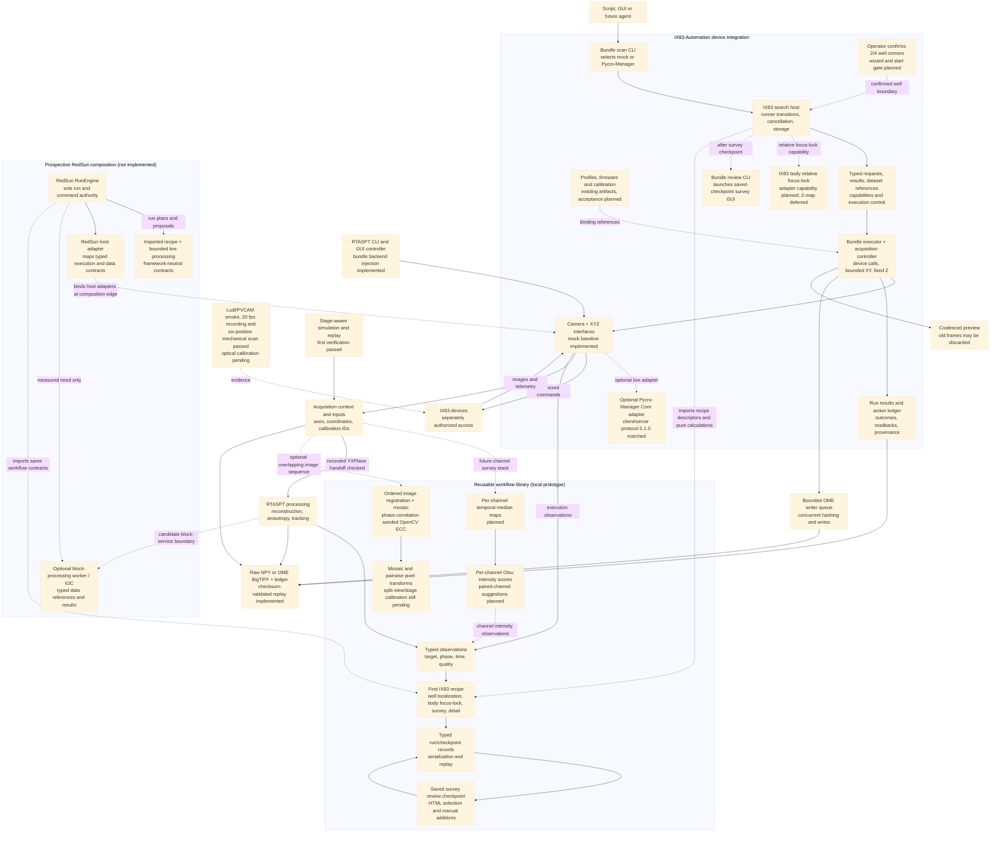

# IX83-Automation architecture flowchart

This composition follows the [setup plan](device_bundle_setup_plan.md) and RTASPT's [sample-search workflow research](../03_external/Realtime-Anisotropy-SPT-Analysis/docs/sample-search-workflow-research.md). The mock-first camera/XYZ-stage package exists at `04_code/ix83_acquisition/`; capture, XYZ movement, finite acquisition and free-run cancellation passed over demo ZMQ on 2026-10-04. RTASPT CLI/GUI/MDA backend-injection hooks now exist, with actual single-detector controller checks passing. See the plan for tested versions and compatibility limits. The `samplescout` library publishes recipe descriptors, calculations and hardware-free records; the bundle CLI/host imports those recipes and owns orchestration transitions and device execution. Seeded and recording/replay checks pass. A six-position 50 x 25 um mechanical scan passed on Pycro-Manager with checksum-verified frames and bounded return to origin; optical calibration and real-specimen targeting remain unverified. The saved-checkpoint review CLI and survey coverage GUI are implemented. The first IX83 recipe now specifies operator-confirmed well corners, IX83 body focus-lock, median channel maps and paired-channel intensity suggestions; corner capture, relative-focus binding, Otsu proposal generation, split-detector calibration and channel-group MDA remain planned. Distribution packaging and broader execution acceptance remain planned.

The planned RedSun direction is a composition alternative, not a second command authority: RedSun's RunEngine would own runs and device policy, importing the same recipe/data/processing contracts. `samplescout` remains a library; a heavy block-processing service is optional and measurement-driven. The single-channel search and stage-scan host now exchange typed execution requests/results, dataset references, declared binding capabilities and cancellation control. RedSun composition and source-path packaging cleanup remain future work.

Implemented first verification: a seeded same-objective survey, calibrated detection, physical-coordinate deduplication and selection, then recorded target movies with RTASPT input handoff. The local library only describes recipes and provides pure calculations; the bundle CLI invokes a bundle-owned runner which interprets them under device limits and owns every physical operation. A saved-checkpoint CLI can open the existing offline map/review page, whose survey overview is coverage polygons plus tile previews. The refined first example recipe adds confirmed well corners, body focus-lock, temporal-median per-channel survey maps, Otsu metrics and split-aware paired-channel suggestions; those recipe-specific stages remain planned. The recent image-stitch utility handles ordered overlapping images in pixel coordinates and is not stage calibration. The six-position hardware scan establishes mechanical scan execution and data capture, not optical calibration or real-specimen targeting. Baseline/perfusion/anisotropy is the second proposed reference recipe.

Processing reports observations; the bundle executor owns physical commands. The existing RTASPT live workflow uses Micro-Manager/Pycro-Manager and napari with exclusive camera ownership. Generic input adapters exist, but ndarray/TIFF consumers and the current live controller retain their documented limitations.
