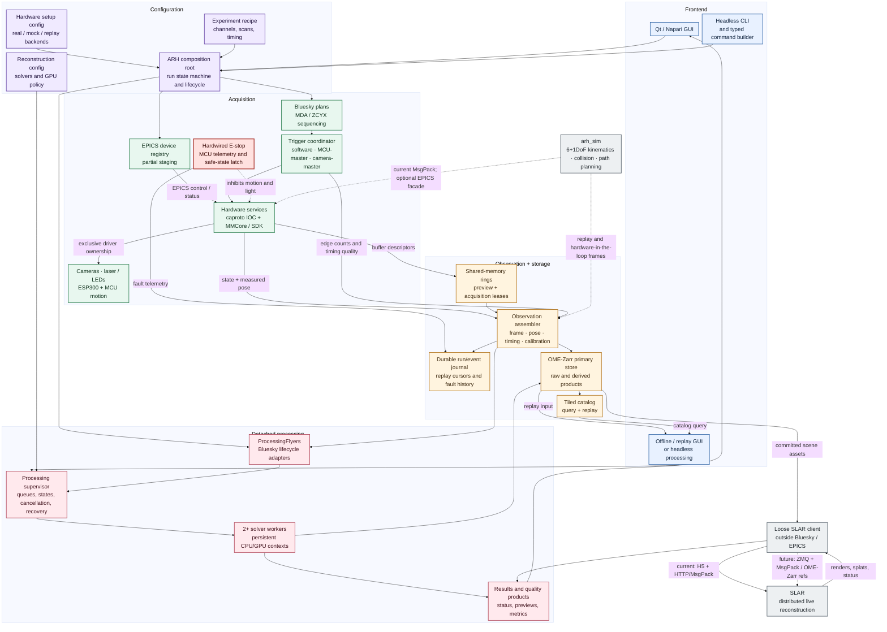

# ARH architecture flowcharts

These diagrams reflect the current restructuring plan. ARH owns acquisition, hardware safety, durable data, and local processing orchestration. `arh_sim` validates motion and 6+1DoF feasibility; SLAR remains a loosely integrated external reconstruction service and may provide advisory next-view recommendations.

## Full ARH application architecture



## Current `redsun-pyhololab` architecture

This is the post-merge RedSun 0.11 `redsun-mimir` composition model, shown with the same layer structure as the proposed ARH figure. It depicts supported upstream contracts plus the retained filter-wheel UI; RedSun 0.10-era donor adapters remain archival code outside the supported container.

```mermaid
%%{init: {"theme": "base", "themeVariables": {"fontFamily": "Inter, Segoe UI, sans-serif", "fontSize": "22px"}, "flowchart": {"nodeSpacing": 14, "rankSpacing": 18, "padding": 10, "diagramPadding": 8, "subGraphTitleMargin": {"top": 12, "bottom": 10}}, "themeCSS": ".nodeLabel { font-size: 22px; } .cluster-label .nodeLabel { font-size: 22px; } .edgeLabel { font-size: 17px; }"}}%%
flowchart TB
    classDef frontend fill:#e8f1ff,stroke:#3568a8,stroke-width:2px,color:#10243e
    classDef config fill:#f0eaff,stroke:#6846a8,stroke-width:2px,color:#21143e
    classDef acquisition fill:#e8f7ef,stroke:#2f8153,stroke-width:2px,color:#12331f
    classDef data fill:#fff4df,stroke:#b47721,stroke-width:2px,color:#3b270d
    classDef missing fill:#f1f2f3,stroke:#727b83,stroke-width:2px,stroke-dasharray:7 5,color:#3d454b

    subgraph FRONTEND["Frontend"]
        direction LR
        entry["mimir entrypoint<br/>QtAppContainer"]:::frontend
        views["Qt views<br/>acquisition, detector, image<br/>motor, light, filter wheel"]:::frontend
    end

    subgraph CONFIG["Configuration"]
        direction LR
        yaml["YAML profiles<br/>plus plugin manifest"]:::config
        factories["Inspectable build/run<br/>container factories"]:::config
        wiring["Typed ProviderKeys<br/>and explicit wiring"]:::config
    end

    subgraph ACQUISITION["Acquisition"]
        direction LR
        engine["RedSun RunEngine<br/>Bluesky plans and actions"]:::acquisition
        presenters["Presenters<br/>acquisition, detector, median<br/>motor, light, filter wheel"]:::acquisition
        devices["Upstream-compatible devices<br/>MMCore cameras/stages, UC2"]:::acquisition
        mocks["Demo and mock devices<br/>camera, stage, light"]:::acquisition
    end

    subgraph DATA["Documents + storage"]
        direction LR
        streams["Bluesky Event streams<br/>live_view and median_scan"]:::data
        median["DocumentRouter median<br/>raw, median, filtered"]:::data
        storage["Per-device BaseStorage<br/>registered sinks"]:::data
        files["Zarr assets and run documents"]:::data
    end

    subgraph GAPS["Outside supported redsun-mimir container"]
        direction LR
        legacy["Legacy donor adapters<br/>serial, shutter/state, ASI/Hamamatsu"]:::missing
        recon["Detached reconstruction<br/>and solver workers"]:::missing
        offline["Offline processing-only<br/>GUI / headless profile"]:::missing
        safety["6+1DoF safety gate<br/>and arh_sim integration"]:::missing
        distributed["SLAR live reconstruction<br/>and remote scene emitter"]:::missing
    end

    entry --> views
    entry --> factories
    yaml --> factories
    factories --> wiring
    wiring --> engine
    wiring --> presenters
    wiring --> devices
    wiring --> views
    engine --> presenters
    presenters --> devices
    mocks -. selectable simulation configuration .-> devices
    devices --> streams
    streams --> median
    streams --> storage
    median --> storage
    storage --> files
    devices --> views
    streams --> views
    legacy -. requires RedSun 0.11 rewrite .-> devices
```

## ARH, `arh_sim`, and SLAR integration

```mermaid
%%{init: {"theme": "base", "themeVariables": {"fontFamily": "Inter, Segoe UI, sans-serif", "fontSize": "22px"}, "flowchart": {"nodeSpacing": 14, "rankSpacing": 22, "padding": 5, "diagramPadding": 5}, "themeCSS": ".nodeLabel { font-size: 22px; } .edgeLabel { font-size: 17px; }"}}%%
flowchart LR
    classDef arh fill:#e8f1ff,stroke:#3568a8,stroke-width:2px,color:#10243e
    classDef sim fill:#edf0f2,stroke:#56616b,stroke-width:2px,color:#20272c
    classDef slar fill:#ffe9ed,stroke:#b04458,stroke-width:2px,color:#42131d
    classDef safety fill:#ffe1df,stroke:#ad3932,stroke-width:3px,color:#42100d
    classDef store fill:#fff4df,stroke:#b47721,stroke-width:2px,color:#3b270d

    subgraph ARH["ARH acquisition and instrumentation frontend"]
        direction TB
        acquire["Bluesky acquisition run<br/>detectors · illumination · stage"]:::arh
        timing["Trigger and timing record<br/>TTL edges · exposure timestamps"]:::arh
        obs["Observation service<br/>frames · measured 6DoF pose · calibration"]:::arh
        store["OME-Zarr + event journal<br/>durable source of truth"]:::store
        proc["Local processing supervisor<br/>ProcessingFlyers + solver workers"]:::arh
        slarClient["Loose SLAR client<br/>outside Bluesky / EPICS"]:::arh
        gate["Safety and policy gate<br/>limits · freshness · operator approval"]:::safety
        stage["Physical stage controller<br/>ESP300 / MCU motion"]:::arh
        acquire --> timing
        timing --> obs
        acquire --> obs
        obs --> store
        obs --> proc
        store --> slarClient
        proc --> gate
        gate --> stage
        stage -->|measured pose at exposure| obs
    end

    subgraph SIM["arh_sim validation service"]
        direction TB
        kin["Forward / inverse kinematics<br/>6+1DoF transforms"]:::sim
        collision["Collision and path validation"]:::sim
        replay["Simulation and replay frames"]:::sim
        kin --> collision
    end

    subgraph SLAR["SLAR reconstruction service"]
        direction TB
        ingest["Scene input<br/>current H5 compatibility path"]:::slar
        live["Distributed reconstruction<br/>gsplat / PSF / MIP processing"]:::slar
        output["Renders · splats · status<br/>checkpoints and quality"]:::slar
        action["Advisory next-view proposal<br/>future live planner"]:::slar
        ingest --> live
        live --> output
        live --> action
    end

    gate -. current MsgPack; optional EPICS facade .-> kin
    collision -. approved / rejected path .-> gate
    replay -. synthetic observations .-> obs
    slarClient -->|current: publish H5, call HTTP/MsgPack| ingest
    slarClient -. future: stream ZMQ + MsgPack or OME-Zarr refs .-> live
    output -->|rendered products and status| slarClient
    slarClient -->|derived products| proc
    action -. advisory only; never direct hardware control .-> gate
    store -->|offline replay| proc

```



Dashed edges indicate validation, replay, future transport, or advisory flows. Solid motion commands remain inside ARH and pass through its safety gate.

